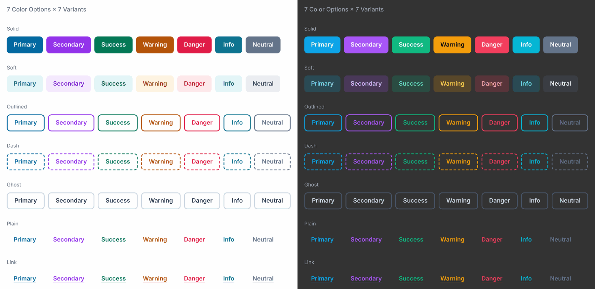
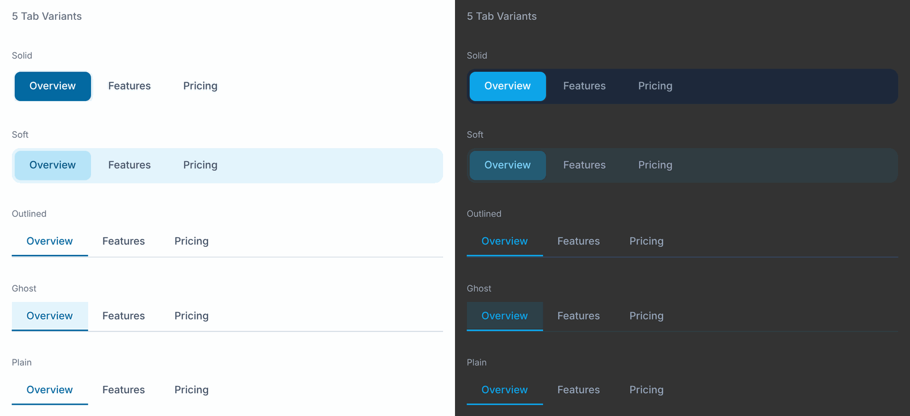
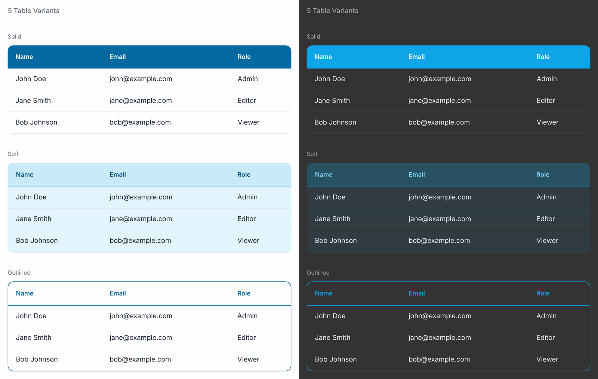
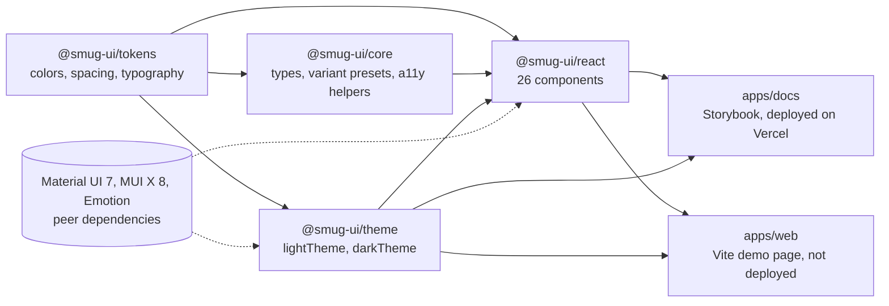

# Sun UI

React components built on Material UI v7, with one `variant`, `color` and `size` API across 26 components, plus design tokens and light and dark themes.

[](https://github.com/tahmidbintaslim/sun-ui/actions/workflows/test.yml)
[](https://sun-ui-brown.vercel.app)
[](LICENSE)

**Live demo: [Storybook](https://sun-ui-brown.vercel.app)**. Every component with live controls, 372 stories in all, deployed from `main` on Vercel.

**Status: in development.** Nothing has been published to npm. The packages were numbered 1.0.0 on `main` before any release; the readiness pass lowered every package to 0.1.0, which is still unreleased. To try it today, run it from source (see [Getting started](#getting-started)).



---

## Contents

- [What it is](#what-it-is)
- [Features](#features)
- [Screenshots](#screenshots)
- [Packages](#packages)
- [Install](#install)
- [Usage](#usage)
- [Components](#components)
- [Accessibility](#accessibility)
- [Tech stack](#tech-stack)
- [Architecture](#architecture)
- [Getting started](#getting-started)
- [Tests](#tests)
- [Deployment](#deployment)
- [Project structure](#project-structure)
- [Known gaps and next steps](#known-gaps-and-next-steps)
- [Contributing](#contributing)
- [License](#license)

## What it is

Sun UI wraps Material UI (MUI) v7 components with Emotion `styled()` and gives them a shared set of props:

| Prop      | Values                                                                         |
| --------- | ------------------------------------------------------------------------------ |
| `variant` | `solid`, `soft`, `outlined`, `ghost`, `plain` (Button also has `dash`, `link`) |
| `color`   | `primary`, `secondary`, `success`, `warning`, `danger`, `info`, `neutral`      |
| `size`    | `xs`, `sm`, `md`, `lg`, `xl`                                                   |

Each component still takes the props of the MUI component it wraps, except the ones Sun UI replaces, so the `sx` prop and your MUI theme keep working.

Sun UI is a good fit if you already use Material UI and MUI X and want soft, ghost and plain styles with one prop API. If you are not on MUI, a library built for your stack will serve you better.

## Features

- 26 components, from Button and TextField to Table, DatePicker and Autocomplete, each with the variant, color and size props above (exceptions are listed under [Components](#components)).
- `@smug-ui/tokens`: 7 color scales with alpha steps, spacing, radius, shadows, z-index, breakpoints, typography and animations, as plain TypeScript objects.
- `@smug-ui/theme`: `lightTheme` and `darkTheme`, built with MUI `createTheme` from those tokens.
- Dark mode: 22 of the 26 components read the MUI palette mode and switch to lighter shades under `darkTheme`. Autocomplete, DatePicker, Progress and Rating use the same shades in both modes.
- ESM and CommonJS builds with TypeScript types for every published package; `@smug-ui/react` starts with a `"use client"` directive.
- 505 unit tests (Vitest, Testing Library, jest-axe in six files) and 372 Storybook stories that run as browser tests in Chromium.

## Screenshots

Captured from the [live Storybook](https://sun-ui-brown.vercel.app). The light theme is on the left, the dark theme on the right.

**Tabs** ([story](https://sun-ui-brown.vercel.app/?path=/story/molecules-tabs--all-variants)):



**Table** ([story](https://sun-ui-brown.vercel.app/?path=/story/organisms-table--all-variants)):



The Button image at the top comes from the [Button colors story](https://sun-ui-brown.vercel.app/?path=/story/atoms-button--colors).

## Packages

The npm packages use the `@smug-ui` scope. That scope is not registered on npm yet (the registry answers "Scope not found"), so publishing needs an npm org named `smug-ui`. The `@sun-ui` scope that would match the project name is already registered by another account (`https://registry.npmjs.org/-/org/sun-ui/package` returns 200), so it is not available unless you own it.

| Package           | Contents                                                                                                       |
| ----------------- | -------------------------------------------------------------------------------------------------------------- |
| `@smug-ui/react`  | The 26 components                                                                                              |
| `@smug-ui/theme`  | `lightTheme` and `darkTheme` (MUI `createTheme`) built from the tokens                                         |
| `@smug-ui/tokens` | Colors (7 scales with alpha steps), spacing, radius, shadows, z-index, breakpoints, typography and animations  |
| `@smug-ui/core`   | Shared types, variant presets, accessibility helpers and headless state helpers (Progress and Rating use them) |
| `@smug-ui/icons`  | Empty placeholder. Private, not published                                                                      |

Each published package ships ESM and CommonJS builds with TypeScript types, and `@smug-ui/react` starts with a `"use client"` directive.

## Install

Once 0.1.0 is published:

```bash
npm install @smug-ui/react @smug-ui/theme \
  @mui/material @mui/icons-material @mui/x-date-pickers \
  @emotion/react @emotion/styled dayjs
```

Material UI, MUI X Date Pickers, Emotion and dayjs are peer dependencies, so your app keeps a single copy of each. `@smug-ui/react` needs React 19, Material UI 7 and MUI X Date Pickers 8. `@smug-ui/theme` works with React 18 or 19.

## Usage

```tsx
import CssBaseline from '@mui/material/CssBaseline';
import { ThemeProvider } from '@mui/material/styles';
import { Alert, Button, TextField } from '@smug-ui/react';
import { lightTheme } from '@smug-ui/theme';

export function App() {
  return (
    <ThemeProvider theme={lightTheme}>
      <CssBaseline />
      <Alert variant="soft" color="success">
        Changes saved
      </Alert>
      <TextField variant="outlined" label="Email" />
      <Button variant="solid" color="primary">
        Continue
      </Button>
      <Button variant="dash" color="info">
        Upload file
      </Button>
    </ThemeProvider>
  );
}
```

Use `darkTheme` for dark mode. More examples are in [DOCUMENTATION.md](DOCUMENTATION.md) and in the [Storybook](https://sun-ui-brown.vercel.app).

## Components

All components take the 5 sizes above. The 7 colors apply everywhere except in three components:

- Autocomplete names the red color `error` instead of `danger`. Its input field ignores `color`: the field styles read `--sun-color-*` CSS variables that Sun UI does not define, so they fall back to MUI's default blue. Its multi-select tags do follow `color`, because they pass it to MUI `Chip`, which takes the color from the theme palette.
- DatePicker names the red color `error` and ignores `color` for the same reason as the Autocomplete field.
- Drawer accepts `color` but never reads it; its styles use neutral shades and the theme's text and background colors.

| Component         | `variant` values                                | Notes                                                           |
| ----------------- | ----------------------------------------------- | --------------------------------------------------------------- |
| Alert             | solid, soft, outlined, ghost, plain             |                                                                 |
| Autocomplete      | solid, soft, outlined, ghost, plain             | Uses `error`; `color` styles the multi-select tags only         |
| Avatar            | solid, soft, outlined, ghost, plain             | Optional `status` dot                                           |
| Badge             | solid, soft, outlined, ghost, plain             |                                                                 |
| Breadcrumbs       | solid, soft, outlined, ghost, plain             |                                                                 |
| Button            | solid, soft, outlined, dash, ghost, plain, link | `loading`, `shape`, start and end icons                         |
| Card              | solid, soft, outlined, ghost, plain             |                                                                 |
| Checkbox          | solid, soft, outlined, ghost, plain             | `label` prop                                                    |
| Chip              | solid, soft, outlined, ghost, plain             |                                                                 |
| DatePicker        | solid, soft, outlined, ghost, plain             | MUI X with dayjs; re-exports `dayjs`; `color` has no effect yet |
| Dialog            | solid, soft, outlined, ghost, plain             | Also exports DialogTitle, DialogContent, DialogActions          |
| Drawer            | solid, soft, outlined, ghost, plain             | Accepts `color` but ignores it                                  |
| Pagination        | solid, soft, outlined, ghost, plain             |                                                                 |
| Popover           | solid, soft, outlined, ghost, plain             |                                                                 |
| Progress          | solid, soft, outlined, ghost, plain             | Linear and circular                                             |
| Radio             | solid, soft, outlined, ghost, plain             | `label` prop                                                    |
| Rating            | solid, soft, outlined, ghost, plain             |                                                                 |
| Select            | solid, soft, outlined, ghost, plain             | Also exports MenuItem                                           |
| Slider            | solid, soft, outlined, ghost, plain             |                                                                 |
| Snackbar          | solid, soft, outlined, ghost, plain             | Also exports SnackbarContent                                    |
| Switch            | solid, soft, outlined, ghost, plain             |                                                                 |
| Table             | solid, soft, outlined, ghost, plain             | Sorting, row selection, pagination, sticky header               |
| Tabs              | solid, soft, outlined, ghost, plain             | Horizontal or vertical, optional panels                         |
| TextField         | solid, soft, outlined, ghost, plain             |                                                                 |
| ToggleButtonGroup | solid, soft, outlined, ghost, plain             | Also exports ToggleButton                                       |
| Tooltip           | solid, soft, outlined, ghost, plain             |                                                                 |

## Accessibility

- Light theme: the `main`, `dark` and `contrastText` tokens reach 4.5:1 text contrast (the WCAG 2.1 AA level for normal text) in the resting state of the solid, soft, outlined, plain and link variants. A unit test in `packages/tokens` checks those pairs.
- Light theme gaps: ghost and plain variants put `main` text on an 8% or 16% tint on hover and press, which drops below 4.5:1 for some colors (danger and neutral on hover). Progress, Rating, Slider and ToggleButtonGroup use the lighter 500 shades instead of `main`, and Autocomplete and DatePicker use MUI's default blue, so the token test does not cover them.
- Dark mode: components switch to lighter shades (`colorScaleForMode` in `@smug-ui/tokens`; the `@smug-ui/core` variant helpers take an `isDark` flag), so `main` text reaches 4.5:1 on the dark page for every color except neutral, and borders and icons reach 3:1. Checkbox, Radio and Switch labels, unselected ToggleButtonGroup text and the Slider value and min/max labels use the dark text tokens (`textColorsForMode`), which reach 4.5:1 on the page and on paper. Still short of 4.5:1: solid fills (white on the 500 shades) for most colors, neutral text, and secondary, danger and neutral text on the lighter paper surface.
- Components rely on the keyboard and ARIA behavior of the MUI components they wrap. Six component test files run jest-axe, and Storybook includes the a11y addon, but the library has not had a full accessibility audit.

## Tech stack

| Area          | Tools                                                                                         |
| ------------- | --------------------------------------------------------------------------------------------- |
| Components    | React 19, Material UI 7, MUI X Date Pickers 8, Emotion, dayjs                                 |
| Language      | TypeScript 5.9                                                                                |
| Build         | tsup (ESM, CommonJS and `.d.ts`), Turborepo 2, pnpm 10 workspaces                             |
| Docs and demo | Storybook 10 (React + Vite) with the a11y, docs, themes and Vitest addons                     |
| Tests         | Vitest 4 (jsdom and browser mode), Testing Library, jest-axe, Playwright Chromium             |
| Quality       | ESLint 9 with typescript-eslint, Prettier                                                     |
| Delivery      | GitHub Actions, Vercel (Storybook hosting), Chromatic (visual review), Changesets, Dependabot |

## Architecture

The repo is a pnpm workspace run with Turborepo. Arrows point from a package to the packages that list it as a dependency. The two apps also list `@smug-ui/tokens`, and `apps/web` lists `@smug-ui/core`; those arrows are left out to keep the diagram readable. Material UI, MUI X, Emotion and React are peer dependencies, so an app keeps one copy of each.



More detail on the prop API and the variant system is in [API_ARCHITECTURE.md](API_ARCHITECTURE.md).

## Getting started

Prerequisites:

- Node.js 22 (see `.nvmrc`)
- pnpm 10.24.0. Run `corepack enable` once and Corepack picks the version from `packageManager` in `package.json`.
- For the Storybook browser tests only: Playwright's Chromium (`pnpm exec playwright install chromium`, once).

```bash
git clone https://github.com/tahmidbintaslim/sun-ui.git
cd sun-ui
pnpm install --frozen-lockfile

pnpm build:packages      # build tokens, theme, core and react (tsup)
pnpm storybook:dev       # Storybook on http://localhost:6006
pnpm web:dev             # demo page on http://localhost:3000

pnpm lint
pnpm type-check
pnpm test:ci             # 505 unit tests
pnpm test:storybook:ci   # 372 Storybook stories in headless Chromium
pnpm build               # packages, Storybook and the web demo
```

Workspace packages resolve to their `dist/` folders, so run `pnpm build:packages` before the tests, Storybook or the demo page.

No environment variables are needed to install, build or test. The optional ones:

| Variable                  | Used by                                | Purpose                                                                        |
| ------------------------- | -------------------------------------- | ------------------------------------------------------------------------------ |
| `SB_URL`                  | `apps/docs/vitest.config.ts`           | Storybook URL used in links in the story test output. Default `localhost:6006` |
| `STORYBOOK_URL`           | `scripts/check-deployed-storybook.mjs` | URL the deploy check tests. Default `https://sun-ui-brown.vercel.app`          |
| `CHROMATIC_PROJECT_TOKEN` | `test.yml` (repository secret)         | Publishes Storybook to Chromatic. Without it the step fails but CI passes      |
| `NPM_TOKEN`               | `publish.yml` (repository secret)      | Publishes the packages to npm on a GitHub release                              |

## Tests

- 505 unit tests in 29 files (Vitest, Testing Library, jsdom): 376 for the components, 35 that render components and the core variant helpers in light and dark mode, 5 that load the built CommonJS bundle with `require()` (skipped until `pnpm build:packages` has run), and 89 contrast checks for the tokens.
- 372 Storybook stories, each run as a test in headless Chromium through Vitest browser mode, including 54 interaction (`play`) functions.
- The CI workflow (`.github/workflows/test.yml`) runs lint, type-check, both test suites and a full build on every push and pull request to `main`. See [TESTING_GUIDE.md](TESTING_GUIDE.md) for the other workflows.

## Deployment

- **Storybook**: Vercel's GitHub integration builds every push with the settings in `vercel.json` (`turbo run build --filter=docs`, output `apps/docs/storybook-static`). `main` deploys to production at https://sun-ui-brown.vercel.app; pull requests get preview deployments, which sit behind Vercel Authentication. After each production deployment, `.github/workflows/storybook-deploy-check.yml` checks that the public URL serves every component.
- **Visual review**: the CI workflow publishes Storybook to Chromatic on pushes to `main` and on pull requests from this repo, using the `CHROMATIC_PROJECT_TOKEN` secret.
- **npm**: `.github/workflows/publish.yml` publishes the public packages when the maintainer publishes a GitHub release tagged `v<version>`. It has not run yet; see [TESTING_GUIDE.md](TESTING_GUIDE.md#releasing).

## Project structure

```
sun-ui/
├── apps/
│   ├── docs/        Storybook config (deployed to Vercel)
│   └── web/         Vite demo page (not deployed)
├── packages/
│   ├── react/       Components, unit tests and stories
│   ├── theme/       MUI light and dark themes
│   ├── tokens/      Design tokens and the contrast test
│   ├── core/        Shared types and helpers
│   └── icons/       Empty placeholder
├── scripts/         Deployed Storybook check
├── docs/images/     README screenshots
└── .github/         CI, release and Dependabot config
```

## Known gaps and next steps

- Not published to npm yet. The first release needs the `smug-ui` npm org (or a different scope) and the `NPM_TOKEN` secret.
- Dark-mode solid fills and some text and hover states fall short of 4.5:1 contrast (see [Accessibility](#accessibility)).
- The `color` prop has no visible effect on DatePicker, on the Autocomplete input field or on Drawer.
- `@smug-ui/icons` is empty.
- The packed packages have been imported and server-rendered from Node (ESM and CommonJS), but not yet tested inside a Next.js or Vite app.

## Contributing

See [CONTRIBUTING.md](CONTRIBUTING.md). Bugs and ideas go in [GitHub issues](https://github.com/tahmidbintaslim/sun-ui/issues). For security problems, follow [SECURITY.md](SECURITY.md).

## License

[MIT](LICENSE). Copyright 2026 Tahmid Bin Taslim Rafi ([@tahmidbintaslim](https://github.com/tahmidbintaslim)) and Sun UI contributors.

Sun UI is not affiliated with or endorsed by MUI (Material UI SAS).
